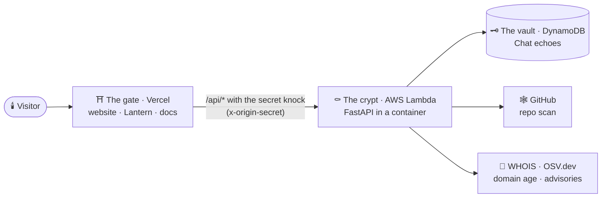

# ⚰️ Gravecast

**A link and repo safety checker that shows its findings as a graveyard, and an installable emergency kit that keeps working on little or no internet.**

[Website](https://grave-cast.vercel.app) · [Lantern](https://grave-cast.vercel.app/lantern/) · [Groove UI docs](https://grave-cast.vercel.app/docs) · Built for Kiroween 2026

---

## What it is

| | Part | What it does | Guide |
| --- | --- | --- | --- |
| 🪦 | **The graveyard** | Paste a link and every problem found rises as a grave, worn by how serious it is. Walk the yard in 3D or read it as a list. Dev mode does the same for a public GitHub repo. | [graveyard.md](docs/guide/graveyard.md) |
| 🏮 | **Lantern** | An installable web app with 31 first aid and survival guides, emergency tools, Chat, Radio, accessibility pads and places nearby. Built for weak connections and usable fully offline. | [lantern.md](docs/guide/lantern.md) |
| 📻 | **Dead tech** | FidoNet-style mail runs, radio teletype, Morse code and WHOIS, brought back where they fit. | [dead-tech.md](docs/guide/dead-tech.md) |
| 👻 | **Games** | Two hidden games: **Ghost run**, the dino game reversed, and **Backwards**, a typing test where you type each line's words in reverse order. | [games.md](docs/guide/games.md) |
| 🎃 | **Groove UI** | Our horror-themed React library behind the look and sound: 2D and 3D components, sixty-plus synthesized sounds, and a comic system for the kit. | [README](packages/grave-ui/README.md) |

Why we built it is on the site's [Our story](https://grave-cast.vercel.app/story) page.

## Highlights

**Link check.** Device-side checks (disguised `@` addresses, punycode look-alikes, bare IPs, no HTTPS, unusual ports), then passive server checks: the full redirect chain, missing security headers, and domain age over WHOIS (port 43, via `whois.iana.org` and the registry). Results never say "safe": they list what was found and what wasn't checked.

**Repo graveyard.** One commit-pinned zipball per scan, read in memory and never executed. It finds leaked secrets (redacted before they leave the scanner), vulnerable dependencies from lockfiles via OSV.dev (with CVSS scoring), risky Python and JavaScript found with tree-sitter syntax trees, risky Docker, Terraform and GitHub Actions files, and missing project-wide protections. Findings are grouped into at most ten graves.

**Lantern.** Its own page, bundle, web manifest and service worker, all scoped to `/lantern/`, so no website code or 3D is cached on the phone. Pages open from the cache first.
- **Chat** keeps an IndexedDB outbox, and messages carry IDs made on the device, so retries never post twice. Background Sync sends them with the app closed where supported.
- **Radio** plays messages as RTTY (5-bit Baudot at 45.45 baud, 2125/2295 Hz), synthesized with Web Audio and no library.

**Accessibility first in Lantern.** A braille pad for people who can't see or speak. A dial pad of ready messages for people who can't hear or speak. A distress signal that can be loud or silent. Kit guides can be read aloud, and every visual control has a plain list beside it.

**Performance.** Docs pages and every 3D scene load lazily, and Groove UI is tree-shakeable. That cut the home page's first load from 2,193 KB to 781 KB of JavaScript. Lantern loads 699 KB, with no three.js at all.

## Games

Answer one of the diary's riddles right while a scan runs, and a ghost appears beside the Scribble pen. Click it to pick a game. It stays found on that browser.

| Game | How it plays |
| --- | --- |
| **Ghost run** | The dino game, the other way round. A ghost drifts left, jumps tombstones and collects coins as the world speeds up. Space, Up arrow or tap to jump, P to pause. |
| **Backwards** | A 30-second typing test: type each line with its words in reverse order, so *The raven watches the gate* becomes *gate the watches raven The*. It scores words per minute and accuracy. |

The lines are generated from small themed word lists (about 250,000 combinations), with no AI and no mock data. Both games are Groove UI components that share one accessible game window, and each keeps its best score in the browser. More in [docs/guide/games.md](docs/guide/games.md).

## Architecture



The browser only ever knocks on one door. The gate passes `/api` calls to the crypt with a secret only it knows, and the crypt turns away anyone else.

| Layer | Stack |
| --- | --- |
| Website and Lantern | React 19, Vite, TypeScript, Tailwind (`apps/gravecast`) |
| Component library | Groove UI: React, Three.js and React Three Fiber, Web Audio, Rough.js (`packages/grave-ui`) |
| API | Python, FastAPI, Pydantic, httpx, tree-sitter (`apps/api`) |
| Storage | DynamoDB when deployed, SQLite locally, behind one store interface |

## Deployment

**Website: Vercel.** The project builds from `apps/gravecast`, installing and building Groove UI first because the app imports its build (`vercel.json` sets both commands). A `routes` entry forwards `/api/*` to the Lambda Function URL. A `request.headers` transform stamps every forwarded request with `x-origin-secret`, read from the `ORIGIN_SECRET` environment variable. The single-page fallback excludes `/api/`, so the app can never answer an API path.

**API: AWS Lambda from a container image.** The image is `python:3.12-slim` plus the AWS Lambda Web Adapter, so the API runs as a normal web app under uvicorn, with no handler code. Lambda's native Web Functions only support Node.js, which is why we use the adapter. The adapter waits for `/health` before serving. Writable paths point at `/tmp`.

**CI/CD: GitHub Actions** (`.github/workflows/deploy-api.yml`). On every push to `main` that touches `apps/api`, it:
1. Runs the API tests.
2. Signs in to AWS with OIDC, so no AWS keys are stored in GitHub.
3. Builds the image for `linux/amd64` with provenance attestations off, which Lambda requires, and pushes it to ECR, tagged with the commit SHA.
4. Updates the function, waits for the update, and calls `/health` with retries for cold starts.

There are no fallback names for the role, repository or function: a missing secret fails the run instead of deploying somewhere else. Lambda's output isn't printed, because it would expose environment variables. Pull requests run the API tests (`ci.yml`), and Vercel builds a preview of every branch.

**Chat on DynamoDB: one on-demand table** (`pk`, `sk`). Each message is a single transaction:
1. It advances a global `seq` counter, checked in the same transaction, so order follows commit order.
2. It stores the message.
3. It writes a message-ID marker that expires through TTL after 30 days, so a retried message is stored once.
4. It drops the echo's oldest message once the echo holds 500.

Reads are strongly consistent. An AWS failure answers `503` "busy" with no details, and the phone's outbox retries.

The full runbook, with every AWS and Vercel setting, is in [docs/DEPLOY_PLAN.md](docs/DEPLOY_PLAN.md).

## Security and privacy

- **The API is reachable only through the website.** An ASGI middleware refuses every request without the matching `x-origin-secret`. It uses a constant-time compare, accepts several secrets at once for rotation, and leaves only `/health` open (so `/docs` is closed too). In Lambda, the API refuses to start without a secret of at least 32 characters. The browser makes no cross-origin calls, so CORS is never needed.
- **Passive, bounded fetching.** The server opens links the way a browser would and never runs their JavaScript. It blocks private, loopback, link-local and cloud-metadata addresses, and checks again after every redirect. Redirects, response size and time are all capped, and every limit lives in `app/config.py`.
- **Rate limits** apply to link scans, repo scans and Chat. They're kept in memory, so each Lambda instance counts on its own.
- **No secrets in findings or logs.** Leaked keys are redacted inside the scanner.
- **Location stays on the device.** Saved places and help messages live in the browser. Help near you calls Amazon Location directly from the phone, using a browser key meant to be limited to that one action and our site's addresses. Gravecast's server never sees a position.

## How we built it with Kiro

**Steering files** (`.kiro/steering/`) kept every session on the same decisions:

| File | Loads | What it enforces |
| --- | --- | --- |
| `gravecast-product.md` | Always | The product baseline, a working agreement (build the current iteration only, update the vision doc before changing a decision, verify before calling it done), and the non-negotiables: passive checks only, honest verdicts, safe fetching, no made-up information |
| `gravecast-backend.md` | Files in `apps/api/**` | Module layout, error shape, settings with `GRAVECAST_*` overrides, safe fetching, tests with no live network |
| `gravecast-app.md` | Files in `apps/gravecast/**` | Groove UI first, tokens only, a plain and fast Lantern, the outbox for anything sent, accessibility as the deciding factor |
| `grave-ui-rules.md` | When relevant | Reusability rules for the library: compose from primitives, no magic numbers, hooks for shared logic, exported and documented props |
| `content-guidelines.md` | When relevant | Plain words in anything a user reads, with no jargon or filler |

**Hooks** (`.kiro/hooks/`) automated the rules:
- **Session start:** loads the Groove UI rules at the beginning of every session.
- **Before every write:** a check runs before each file write or edit, and for anything in `packages/grave-ui` it checks the code against those rules: no hard-coded colours or magic numbers, tokens only, composed from primitives, documented interfaces. During the build it turned up bare numbers that became named tokens, and a duplicated close icon that became a shared `CloseMark`.

**One source of truth.** [docs/GRAVECAST_VISION.md](docs/GRAVECAST_VISION.md) holds the product and a decisions table. Decisions such as moving Chat's DynamoDB table to on-demand and adding the easter egg were written there before the code changed.

**MCP.** The AWS Documentation MCP server let Kiro check the deploy plan against AWS's own docs. It confirmed, for example, that a public Function URL needs both `lambda:InvokeFunctionUrl` and `lambda:InvokeFunction`, how many units reserved concurrency always keeps back, and DynamoDB's free-tier terms.

**Verification.** Changes were checked before they were called done: builds, lint, the Groove UI type check, the API tests, and headless-browser runs of the real pages.

## Quick start

```bash
# API, at http://localhost:8000
cd apps/api && python -m venv .venv && source .venv/bin/activate
pip install -e ".[dev]" && uvicorn app.main:app --reload --port 8000

# Website and Lantern, at http://localhost:5173 (in a second terminal)
cd packages/grave-ui && npm install && npm run build
cd ../../apps/gravecast && npm install && npm run dev
```

You need Python 3.10+ and Node.js 20.19+. Settings, tests and the project layout are in [docs/guide/development.md](docs/guide/development.md).

## Documentation

| Doc | What's in it |
| --- | --- |
| [docs/guide/](docs/guide/) | Feature guides: [graveyard](docs/guide/graveyard.md), [Lantern](docs/guide/lantern.md), [dead tech](docs/guide/dead-tech.md), [games](docs/guide/games.md), [development](docs/guide/development.md) |
| [GRAVECAST_VISION.md](docs/GRAVECAST_VISION.md) | The product, every decision, and why |
| [REPO_SCAN_DESIGN.md](docs/REPO_SCAN_DESIGN.md) | How the repo scan works |
| [KIT_SCRIPTS.md](docs/KIT_SCRIPTS.md) | The survival kit's sourced captions, panel by panel |
| [DEPLOY_PLAN.md](docs/DEPLOY_PLAN.md) | The deployment runbook |

## Status

This is a hackathon prototype.
- **Kit guides:** drafts taken from their cited sources (IFRC, WHO, AHA), not yet medically reviewed. Always follow official guidance and your local emergency services.
- **Chat and Radio:** public, so don't post personal details there.

## Licence

Apache 2.0. See [LICENSE](LICENSE).

---

<p align="center">
  🪦<br/>
  <em>Here lie the bugs we found, the links we doubted, and the nights without signal.</em><br/>
  <em>Leave the lantern on.</em> 🏮
</p>
